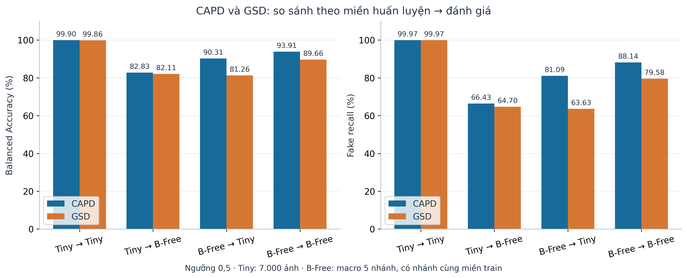
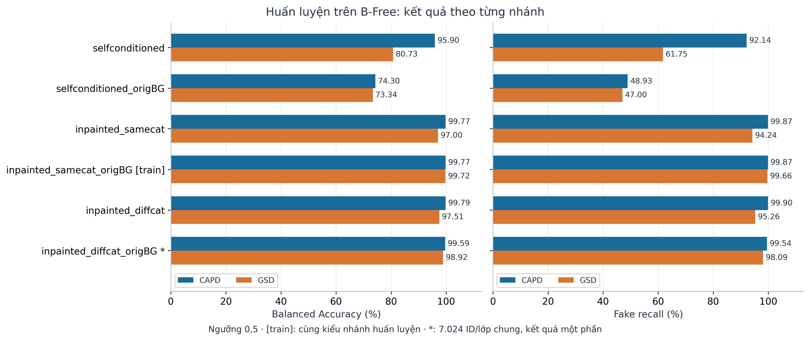
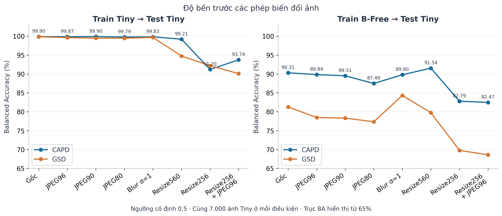
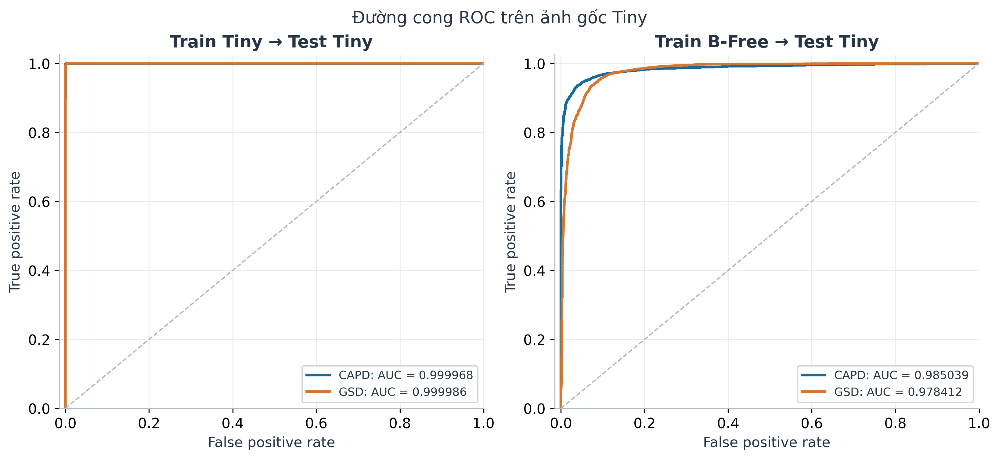
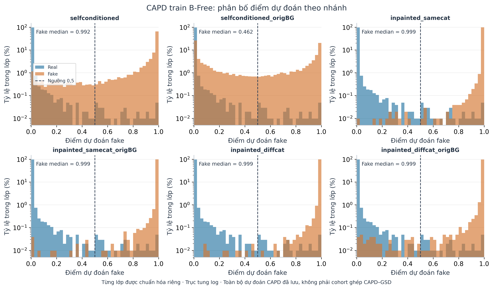
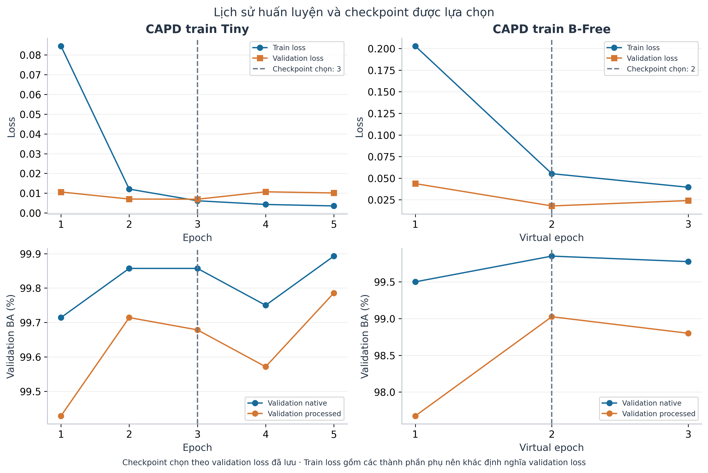
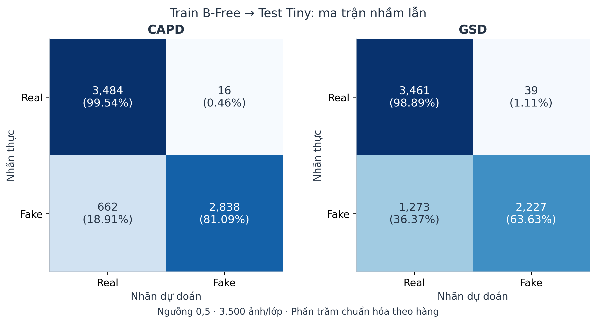
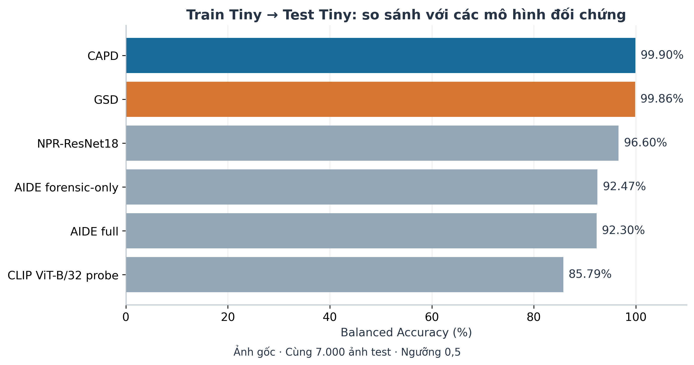

# Bộ hình kết quả thực nghiệm CAPD và GSD

Mỗi hình có PNG 300 dpi để chèn Word, PDF/SVG dạng vector để dàn trang. Số liệu lấy từ bản artifact Kaggle đã tải trong repository; không chạy lại mô hình và không tạo ảnh minh họa giả. Nhãn Tiny giữ đúng tên dataset Tiny-GenImage, không đại diện cho toàn bộ GenImage.

Ưu tiên hình 01, 02, 03, 06, 07 trong báo cáo chính; hình 04, 05, 08 dùng khi cần phân tích thêm. Hình 01/02 dùng ngưỡng 0,5 và CAPD full pooling. B-Free macro năm nhánh bao gồm nhánh cùng miền train, không được mô tả là trung bình thuần held-out. Nhánh thứ sáu trong so sánh là partial; không gộp vào trung bình năm nhánh. Không suy luận ý nghĩa thống kê từ một lần chạy.

Nguồn và phiên bản được lưu trong [bản đồ artifact](../EXPERIMENT_DATA_URLS.md), cùng provenance trong các thư mục source. File sources.json ghi SHA-256 của các file dùng trực tiếp để tạo hình. Các hình được vẽ lại từ số liệu, không phải hình gốc xuất từ notebook.

Các link nguồn chính:
- [CAPD train Tiny, v1](https://www.kaggle.com/datasets/hadinho0710/checkpoin-capd-train-tiny)
- [CAPD test Tiny/B-Free, v1](https://www.kaggle.com/datasets/hadinho0710/eval-capd-test-tiny-bfree)
- [CAPD train B-Free, nguồn checkpoint được evaluator ghi](https://www.kaggle.com/datasets/hadinho0710/check-point-train-capd-bfree)
- [CAPD train B-Free test Tiny/B-Free, v1](https://www.kaggle.com/datasets/hadinho0710/eval-train-capd-bfee-test-tiny-and-bfree)
- GSD và baseline: xem bản đồ artifact và bảng metrics_comparison.json gốc để đối chiếu từng run.

## 01_overview

**Chú thích đề xuất:** So sánh BA và fake recall của CAPD và GSD trong bốn thiết lập huấn luyện–đánh giá. Kết quả B-Free là trung bình năm nhánh, bao gồm inpainted_samecat_origBG thuộc miền huấn luyện B-Free.

Nguồn trực tiếp: metrics_comparison.json: tiny_native, bfree_common_five.

## 02_bfree_branches

**Chú thích đề xuất:** BA và fake recall theo nhánh khi huấn luyện trên B-Free. Năm nhánh đầu được đối chiếu trên 10.304 ID mỗi lớp; nhánh thứ sáu chỉ so sánh trên 7.024 ID mỗi lớp đã có kết quả ở cả hai mô hình và không đưa vào trung bình năm nhánh.

Nguồn trực tiếp: metrics_comparison.json: bfree_branch_metrics, bfree_partial7024.

## 03_robustness

**Chú thích đề xuất:** So sánh độ bền của CAPD và GSD trên Tiny theo miền huấn luyện. Mỗi điều kiện sử dụng cùng 7.000 ảnh; ngưỡng được giữ ở 0,5. PNG roundtrip và chỉ fake JPEG96 được lược khỏi hình để tránh trùng lặp.

Nguồn trực tiếp: metrics_comparison.json: tiny_case_metrics.

## 04_roc_tiny

**Chú thích đề xuất:** Đường cong ROC được tính từ điểm dự đoán của từng ảnh trên cùng tập test Tiny. AUC được hiển thị sáu chữ số thập phân để phân biệt các kết quả gần 1; hai đường ở thiết lập train Tiny gần như chồng nhau.

Nguồn trực tiếp: Four native prediction CSVs; AUC checked against metrics_comparison.json.

## 05_score_distributions

**Chú thích đề xuất:** Phân bố điểm dự đoán của CAPD huấn luyện trên B-Free. Các histogram được chuẩn hóa riêng theo lớp, dùng trục tung log; đường đứt biểu diễn ngưỡng 0,5. Nhánh selfconditioned_origBG có nhiều ảnh giả nhận điểm dưới ngưỡng. Hình dùng toàn bộ dự đoán CAPD, khác cohort ghép dùng trong hình so sánh.

Nguồn trực tiếp: CAPD TN2 predictions_bfree.csv, full pooling.

## 06_training_history

**Chú thích đề xuất:** Diễn biến train loss, validation loss và validation BA của CAPD. Checkpoint train Tiny được chọn tại epoch 3; checkpoint train B-Free tại virtual epoch 2, theo tiêu chí validation loss trong artifact. Train loss và validation loss có thành phần khác nhau nên không dùng trực tiếp khoảng cách giữa chúng để kết luận overfitting.

Nguồn trực tiếp: CAPD R2/B2 history.json and selected_checkpoint.json.

## 07_transfer_confusion

**Chú thích đề xuất:** Ma trận nhầm lẫn của CAPD và GSD khi huấn luyện trên B-Free và đánh giá trên Tiny. CAPD bỏ sót 662 ảnh giả, so với 1.273 ảnh ở GSD; số ảnh thật bị nhận nhầm cũng giảm từ 39 xuống 16.

Nguồn trực tiếp: metrics_comparison.json: tiny_native counts.

## 08_tiny_baselines

**Chú thích đề xuất:** So sánh BA trên cùng 7.000 ảnh gốc Tiny của các mô hình huấn luyện trên Tiny. CAPD và GSD đạt kết quả gần tương đương; chênh lệch BA khoảng 0,04 điểm phần trăm.

Nguồn trực tiếp: metrics_comparison.json: tiny_native.

